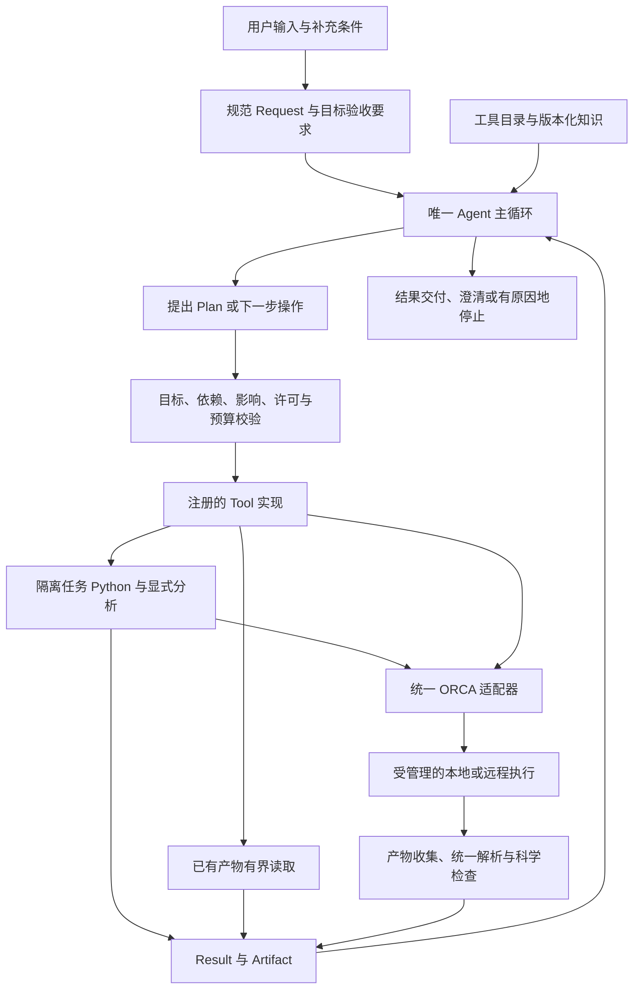

# 通用 ORCA 计算 Agent：从零建设骨架方案

> 版本：2.1；日期：2026-10-18
> 用途：新项目的产品边界、运行时契约、开发原则与分阶段验收基准。  
> 状态：设计方案，不代表代码已实现或能力已验证。  
> 执行顺序：先本地真实测试，再接入服务器或集群。

本文是唯一现行总蓝图。2.1 版按用户于 2026-10-18 明确采用的 [Code as Tools 专项实施方案](CODE-AS-TOOLS-IMPLEMENTATION-PLAN.md) 同步生成代码、开放目标、结果可信度和配置契约；用户已决定冲突处以专项方案为准，依据见 [0031](decisions/0031-code-as-tools-contract.md)。专项方案规定当前逐步实施顺序，不另立总蓝图。文中的目录和接口是建设约定，不代表代码已经实现或能力已经验证，也不据此自动启动后续步骤。历史决策和验收事实保留，不因契约更新自动升级。

阅读顺序：第 1—4 节确定产品、权威来源和目标；第 5—11 节规定运行契约；第 12—15 节用于组织代码、拆分任务和验收；第 16 节提供参考来源。

## 1. 产品定位与范围

### 1.1 要建设的系统

建设一个能够理解自然语言科学需求，使用 ORCA 及必要辅助工具，组织计算、查询已有证据、进行可复算分析，并根据结果自主调整后续工作的 Agent。

产品应同时支持三类任务：

| 任务 | 典型行为 |
| --- | --- |
| 新计算 | 从对象、条件和目标出发，规划并执行真实科学操作 |
| 已有结果分析 | 导入或引用文件，发现数据，解释可支持的结论和缺项 |
| 计算与分析交替 | 检查已有证据，仅在需要且已授权时补算，再更新结论 |

构象、热化学、光谱、NEB 等属于能力实例，不构成固定主流程。长期覆盖常见分子 DFT，并按实际需求扩展 ORCA 的其他量子化学方法。

“通用”由固定通用操作、现场生成的任务 Python/ORCA 输入、开放证据和反馈决策体现。核心验收目标是同一个冻结版本面对不同任务，无需开发者新增任务工具、生产解析器、性质端口或预写解题脚本。执行范围、检查覆盖和可交付结论分别披露；不能承诺任意 ORCA 输入或任意科学问题均可自动完成。

### 1.2 首个可用版本的要求

首个可用版本必须同时证明：

1. 自然语言请求能驱动真实 ORCA 计算。
2. 能依据真实失败，在有限预算内作合法修复。
3. 能依据成功结果，调整计划并执行新增的必要操作。
4. 能导入、发现和查询已有结果，不因缺少标准字段就要求重算。
5. 能完成至少一种跨结果的确定性派生量分析。
6. 能在证据不足、不适用或预算耗尽时准确停止并交付部分结果。

先用小体系验证这些行为，再扩大科学能力与计算规模。

### 1.3 如何衡量覆盖范围

逐步建立 30—50 个代表性科学请求，按任务族、体系、方法、环境和交付方式分布，冻结一部分作为保留测试。该规模是能力评测建设目标，不是阶段 A 的启动前提。

每项能力分别记录：可构造输入、可执行、可解析、可科学验证、可完成目标、可自动修复，以及各项证据对应的版本和适用范围。不得压缩成单一的 `supported: true`。

发布时报告测试分布、通过数、部分完成数、未验证数和成本。样例通过率不能直接表述为“支持大多数 ORCA 功能”。

## 2. 必须遵守的开发原则

| 编号 | 不可绕过的约束 |
| --- | --- |
| P01 | 第一交付是真实 ORCA 计算及有界失败事实；基础设施必须服务于实际用例。 |
| P02 | 长期运行时领域对象仅有 Request、Plan、Step、Tool、Run、Result、Artifact。 |
| P03 | 采用一个 Agent 决策主循环；Tool 是执行边界；Plan 组合 Step，不固定 Opt/Freq/SP 协议。 |
| P04 | ORCA 输入与执行管理共用一套生产责任链；已有解析与科学检查统一复用，生成代码可解析新性质为观察但不形成隐式科学资格链。后端差异通过明确适配实现。 |
| P05 | 模型提出意图、计划、参数、任务代码和修复建议；程序决定是否可执行及科学检查是否通过。 |
| P06 | 模型可生成任务 Python 和 ORCA 输入，经 Tool 校验后仅在受管理、隔离的任务环境执行；不得执行任意 shell、越界访问、修改产品源码或执行许可，模型及脚本不能自行宣告科学通过。 |
| P07 | 用户目标及最低证据要求独立于 Plan；计划修订不能偷换物理量、条件或验收标准。 |
| P08 | 模糊输入可以逐步澄清；默认、继承、推断、自动选择和用户明确要求必须可区分，并保留实际运行条件。 |
| P09 | 每个新结果先检查其对目标和计划的影响，再选择下一步；成功反馈与失败反馈同等重要。 |
| P10 | 证据读取成功、科学输出通过和用户目标完成分别记录，不能互相代替。 |
| P11 | 初始几何与历史原始证据不可覆盖；每次尝试独立；成功科学端口不得发布未验证数值或未收敛优化结构。 |
| P12 | 原始证据可发现、可有界查询；未注册性质可作为观察计算、分析和带验证说明地交付，但不能获得未经检查的科学资格或降低用户最低证据要求。 |
| P13 | 只读查询不得暗中启动转换或计算；执行影响、文件依赖和成本在执行前明确。 |
| P14 | 重试、模型调用、计划修订、内部子计算和实际资源均有有限预算；换 ID、恢复或暂停不清零。 |
| P15 | 预期失败保留结构化诊断与原始文件；无静默模拟回退、猜测数值或无条件重试。 |
| P16 | 科学任务优先由固定通用 Tool 与现场生成代码组合完成，无须按任务新增求解 Tool、生产解析器或性质端口；执行边界和科学保证的扩展仍须局部契约与测试。主循环不得按具体科学工具名称分支。 |
| P17 | 工具目录、参数 schema、执行校验与输出声明来自同一工具定义，避免多套同义协议。 |
| P18 | 文件、检索资料和工具输出作为不可信数据处理，不能授予权限；凭据不进入模型上下文或产物。 |
| P19 | 阶段名只进入文档、任务和提交记录；离线模拟、真实模型、真实 ORCA、真实集群证据分别报告。 |
| P20 | 同一 Run 只有一个协调者；并发额度在整个执行环境中生效，不能被多个 Run 绕过。 |

必要的局部类型结构允许存在，例如尝试、检查项、成员清单、方法配置、代码引用、输入 manifest、内部调用回执、通用观察和执行句柄。限制的是独立领域生命周期和重复框架，不是类型安全。

不提前建设 Kernel、Reducer、Service/Repository 分层、事件总线、分布式数据库或多 Agent 平台；不迁移旧项目的数据库、outbox、launch ticket 或旧对话运行协议。按职责提取函数和模块，避免巨型 Agent 文件，也避免大量空抽象。

## 3. 架构、对象与权威来源

### 3.1 总体结构



所有需要执行或访问产物的动作经过 Tool。普通知识回答无需计算 Plan；数据查询仍受同一工具边界管理，但不强行创建 ORCA 计算步骤。

### 3.2 七个领域对象

| 对象 | 核心职责 | 边界 |
| --- | --- | --- |
| Request | 用户原文、一般科学目标、对象与条件、自动选择范围与来源、未决歧义、最低证据及交付要求、版本 | 不保存进程状态；不是模型可随意重写的目标草稿 |
| Plan | 当前 Step 依赖图、目标到证据的映射、选择理由、Request 版本、计划修订与反馈决策 | 实现目标，不拥有修改目标或最低检查的权力 |
| Step | Tool 名称、类型化参数、确定的代码/输入版本、前置检查、逻辑步骤身份 | 不直接管理进程或判断科学成功 |
| Tool | 参数与产物契约、执行影响、适用范围、实现、检查与修复候选 | 不各自运行 Agent 循环或工作流引擎 |
| Run | 执行状态、Request/Plan 绑定、配置与许可快照、尝试、内部调用记录、累计预算、句柄、单协调者状态 | 不复制全部科学内容；不增加平行 Job/Record 生命周期 |
| Result | 执行事实、逐输出科学检查、合格数值与引用、通用证据观察、分析产物、目标满足情况与诊断 | 不用模型文本补数值；操作成功不等于科学成功 |
| Artifact | 不可变脚本、输入、几何、日志、表格、图片、检查点、原始输出及其来源、hash、角色和 manifest | 不自行认证科学含义；外部产物不伪造生成 Run |

尝试状态放在 Run，科学调用定义放在 Step。工具注册表保存 Tool 定义；文件存储保存其余对象及版本，不为每个局部结构增加独立服务。

### 3.3 谁决定什么

| 内容 | 权威来源 | 模型可以做什么 |
| --- | --- | --- |
| 用户想回答的问题 | 用户明确输入及可追溯的规范化 Request | 提议解释、识别歧义、请求补充 |
| 已支持能力的最低证据 | 版本化能力规则和确定性检查代码 | 选择适用能力，不能删除最低要求 |
| 达成目标的路径 | 通过校验的 Plan | 规划、组合、调整顺序和修复 |
| 资源、文件范围与执行许可 | 用户授权、项目配置及 Run 快照 | 在范围内提出调用 |
| 数值、执行事实、检查状态 | 原始产物、受控解析、后端与检查程序 | 阅读、比较、解释 |
| 结论强度与剩余疑问 | 已有证据及明确限制 | 给出有依据的解释与建议，不越过证据 |

受控规则只能验证已定义的条件，不能证明任意自然语言推论正确。缺少专用检查器时保留原目标、验证缺口及请求允许的交付方式；不能以缺少注册端口为由丢弃目标，也不能静默替换物理量或降低明确证据要求。

## 4. 输入、模糊表达与目标验收

### 4.1 唯一规范 Request

输入先形成一个规范 Request。至少保留：

- 用户原文与当前任务范围。
- 分子/体系身份、几何来源、总电荷、多重度及相关状态。
- 方法、环境、温度、标准态等已知条件。
- 必须交付的物理量、比较关系或证据内容。
- 必需目标、可选目标、精度要求和成本偏好。
- 每个关键条件的来源：用户指定、历史继承、允许默认、推断、Agent 自动选择或待确认；另存实际运行条件。
- 未决歧义、目标验收要求、检查规则版本及 Request 修订。

模型输出语义建议和逻辑引用；程序生成持久 ID、路径、hash 与状态。中间响应使用少量局部 schema，不建设多层长期意图对象。

采用 [0056](decisions/0056-simplify-execution-workflow.md) 的新 Run 可直接引用程序生成的原文片段、明确生产 Step 的输出口或文件键。程序绑定真实范围、产物与 hash，保持原始要求、实际条件和检查资格；不要求模型反复抄写已知元数据，不能从文件名推断几何资格或选择不明确的“最新文件”。新旧规则由不可变 `workflow_policy` 区分，历史 Run 不自动升级。

### 4.2 模糊输入处理规则

| 输入情况 | 行为 |
| --- | --- |
| 条件可从明确上下文继承 | 继承并保留来源；多个候选有歧义时询问 |
| 存在已允许的科学默认 | 使用并披露，不把默认记成用户指定 |
| 未指定方法、基组或常规计算步骤且在自动选择范围内 | Agent 选择并说明依据；固定条件与最低证据保持不变 |
| 不同解释会改变科学问题 | 给出简短候选，只询问关键缺项 |
| 用户提供相互冲突的条件 | 标记冲突，暂停依赖该条件的步骤 |
| 缺少信息、专用检查器或运行依赖 | 分别记录原因；缺少检查器不单独禁止计算和带验证说明的交付，缺少关键依赖则阻止相应执行 |
| 只查询已有结果 | 优先查询，不将缺字段自动解释为补算授权 |

“比较稳定性”“算一下光谱”“沿用刚才设置”等应有专门验收。明确目标所需的信息由具体能力决定，不要求用户每次填完全部 ORCA 参数。

用户于 2026-10-20 明确取消一般名称查询的额外中文同义词/交叉引用确认门槛。新身份契约保留用户原名和实际查询名及其推断来源；受控 PubChem 性质查询得到唯一候选，分子图、分子式、电荷及明确附带公式检查通过即可进入已有几何准备流程，不再请求同义词或 Wikidata。该检查保证查询候选的结构信息自洽，不宣称独立认证推断翻译、实验样品或电子基态。历史身份契约和结果保持原版本；歧义、冲突和未确定立体化学按实际影响处理，见 [0054](decisions/0054-simplify-name-resolution.md)。

待澄清期间，只允许继续独立、已授权且不会被答案推翻的工作。缺少身份或电子态等关键条件时，不先猜测执行再补确认。

### 4.3 目标验收结构

在 Request 内保存局部验收结构，每个目标至少包括：

| 字段含义 | 约束 |
| --- | --- |
| 目标标识与原文依据 | 能追溯到用户要求；必需与可选分别标明 |
| 所需物理量或交付类型 | 区分电子能、焓、自由能、结构、谱图、原始字段查询等 |
| 对象与条件 | 明确比较双方、状态、环境及适用条件 |
| 必需证据与交付要求 | 引用所需结果角色、来源和验证覆盖；允许一般性质名称及通用产物，不依赖尚未存在的实际文件 |
| 最低检查及版本 | 保留用户明确要求及适用的已启用能力规则；没有专用规则时记录缺口，不能由模型或脚本填写通过布尔值 |
| 未决项 | 关键歧义未解决时，不允许该目标通过 |

例如，“比较 A、B 在指定溶剂和温度下的自由能”不能由两个单点电子能及其差值通过验收。即使各 Step 成功，缺少所需自由能证据时，该目标仍未完成。

“读取文件中某字段”可按提取准确性完成；请求允许交付带验证说明的计算观察时，可按实际来源、条件与检查覆盖判断该交付是否完成；“报告通过指定科学检查的某物理量”仍必须满足这些检查。不存在专用检查器时，用户明确要求的最低科学证据不能改为观察或报告生成来满足，否则标为部分完成或证据不足。执行完成、科学通过、目标满足、报告生成分别记录。

### 4.4 多轮输入和修改权

后续消息先区分查询、补充缺项、修改目标、改变许可、暂停和取消。“看看结果”“继续”本身不扩大预算，也不改变科学条件。

用户补充或纠正导致 Request 修订时，保留原文、版本差异和来源；检查受影响的计划、许可和产物适用性。已启动尝试的输入与来源始终保持原条件，不回填为新版本。

Plan 可以改变取证路径，不能单方面降低 Request 的必需目标或最低检查。真正改变科学问题或授权范围时由用户决定；既有授权内的常规修复无需逐步重复确认。

## 5. Tool 契约与调用边界

### 5.1 一个工具定义包含什么

| 声明 | 必须表达的内容 |
| --- | --- |
| 用途 | 操作含义、适用目标、不能据此推出的结论 |
| 参数 | 类型、单位、范围、默认来源、参数组合兼容性 |
| 输入 | 产物角色、来源要求、结构/态信息、前置科学检查 |
| 输出 | 可发布的科学端口、证据观察、诊断和部分结果 |
| 影响 | 文件读写范围、是否运行外部程序、是否提交科学作业 |
| 资源 | 上界、内部子任务规模、超时与取消行为 |
| 检查 | 逐输出成功条件、最低规则版本、不可验证情况 |
| 恢复 | 允许的代码/输入修订、有依据的修复候选、不可改变的条件与最大次数 |
| 实现与验收 | 注册的实现入口、程序版本、真实证据与适用范围 |

参数 schema 与兼容性规则不同：单个关键词合法，不保证组合合法。执行前还须确定所触发的计算路径及成本。

工具定义可以包含局部类型化的“执行影响”字段，不增加长期领域对象。“确定性分析”仍可能写文件、启动进程或占用大量资源；不能仅靠一个类别自动获得许可。

具体影响由工具定义及合法参数确定，程序在执行前校验；不能接受模型提交的“这是只读”标记作为依据。

### 5.2 模型如何调用工具

调用遵循：模型提出名称和参数 → 注册表定位固定实现 → 程序校验 → 保存尝试与预算占用 → 执行 → 保存 Result → 进入反馈循环。

模型可保存任务 Python 与 ORCA 原生输入为不可变 Artifact，通过固定通用工具提交代码/输入引用及 manifest。程序解析授权引用、核对 hash、路径、执行影响与资源，固化 Step 所用版本；模型不能自行指定任意磁盘路径或授予执行许可。任务代码仅在已验证的受管理隔离环境执行，代码内容不能获得产品内部 Store、CLI、凭据、源码或任意 shell 权限。

当前局部实现由 `workspace.write` 创建有界 UTF-8 文件，归档完成后才可引用其真实 ID/hash。当前 Run 自产文件的使用资格来自已结算的生产 Call/Attempt、Result 绑定及 hash 核对，不修改许可快照；未知生产状态的文件不自动成为可执行输入。具体边界与独立验证见 [0034](decisions/0034-first-generated-code-delivery.md)。

固定通用能力包括工作区文件读写与发现、有界证据读取、版本化文档查询、身份与结构准备、`python.execute`、`orca.run` 及现有状态控制；实际名称以唯一工具定义为准。Python 通过薄 SDK 请求 ORCA，和直接 `orca.run` 共用同一执行入口、Run 协调者与预算。SDK 不包含构象搜索、扫描或光谱求解等预写任务算法。只有接口契约并不代表工具已经实现或获准执行。

查询可作为即时只读调用留在当前 Run 记录中，无须制造未来计算依赖图；涉及执行、新产物或下游依赖的操作必须形成明确 Step。二者共用 Tool 定义、影响校验与调用记录，不另建隐式执行通道。

没有活动 Run 时，可创建轻量只读查询 Run，允许 Plan 缺省，保存实际调用与证据来源。生成代码、分析产物及科学执行均须绑定明确 Plan 和 Step；查询记录不伪造成 ORCA 运行记录。

### 5.3 参数扩展与新能力

- 方法、基组、分子和一般科学目标不由固定枚举决定是否可表达。用户条件、自动选择与实际运行条件分别保留，执行校验依据依赖、影响、许可和预算。
- 新科学任务优先由固定通用能力与现场生成代码实现搜索、循环、筛选、拟合、解析和绘图；不要求先新增科学 Tool、生产解析器或性质端口，也不把任务算法隐藏在 SDK。
- 扩展可执行程序、执行边界或声明新的科学保证时，仍增加局部契约、适配与测试；已有检查的最低标准不降低，主循环不增加科学名称分支。
- OPI 输入与原生 ORCA 输入使用同一执行链。原生输入声明依赖 manifest、资源和影响；不按方法白名单限制全部科学语法。会触发额外程序、多作业或未知执行影响的输入，只有在能够管理、隔离和核算时放行，否则返回具体原因。没有专用科学检查器不等于执行影响未知。

## 6. Plan、反馈循环与状态

### 6.1 Plan 的组成

Plan 是当前可执行 Step 的有向无环图，绑定 Request 版本，并记录每个必需目标由哪些证据满足、哪些仍待探索。

尚未确定的科学路径保留为目标缺口，不伪造工具、参数或未来产物。同一工具可以多次使用，已有有效输入可以跳过准备步骤。

规划时，未来输出引用“生产者 Step + 输出、通用产物角色或检查端口”，并声明用途与所需保证；消费者执行前，由程序解析并固化为具体尝试、Result、Artifact、代码/输入 manifest 与检查版本。历史产物可以直接绑定具体引用。禁止按“最新文件”选输入。通用产物存在不自动满足要求合格科学输出的依赖。

数据依赖与科学依赖分别表达：存在几何不等于极小值检查通过。只有消费者要求的条件满足，才能启动该消费者。

### 6.2 修订规则

每份修订建议绑定所依据的 Request、Plan 版本和新证据。程序依次检查目标覆盖、工具能力、依赖、条件、执行影响、许可和累计预算，通过后保存修订，再启动新尝试。

修订可增量表达：程序沿用可信已结算 Step 的准确冻结定义及其已结算依赖闭包，并保留未显式变更的既有目标绑定；新增执行和绑定变更由模型明确提出。不得自动补入遗漏的未结算执行、改写历史、降低最低证据或重置预算，补全后仍校验完整 Plan。见 [0038](decisions/0038-incremental-plan-revisions.md)。

未启动步骤可以新增、替换或取消；已启动尝试不可改写输入。旧作业可以按明确规则保留或取消，其结果始终归属原来的条件和版本。

条件变化时，重新检查受影响的当前消费绑定与目标适用性。原结果在原条件下的检查记录保留；文件损坏、解析错误与“当前不适用”分别处理。

过期的模型建议必须重新校验，不能覆盖用户刚补充的条件。计划修订不能通过换步骤 ID 重置用量。

### 6.3 唯一主循环

1. 读取当前 Request、Plan、Run、工具能力及证据索引。
2. 处理取消、暂停、执行期限；对现有作业对账、收集或等待。
3. 解析新产物，更新逐输出检查、累计用量和目标满足程度。
4. 每个新 Result 先判断是否改变计划适用性或后续操作的必要性。
5. 必需目标已有充分证据时进入交付；否则识别缺项、失败或新的科学观察。
6. 必要时向模型提供有界上下文，选择查询、修订、修复、澄清或停止。无新决策需求且下一步仍有效时可以直接继续。
7. 校验拟执行动作，保存合法修订和尝试，再通过 Tool 执行。
8. 等待用户或作业时保存状态并让出控制；到达停止条件时保留证据并生成交付。

机械继续策略仅对新 Run 显式冻结启用，历史缺字段保持关闭。目前只识别工具定义声明的不可变文件写入反馈：成功回执、完整文件与原冻结 Step 一致、目标状态未改变时，程序可选已批准的 ready Step。仍先检查消息、控制版本、未决执行、依赖和最终解释余量，记录确定性决策并占用轮数；后续执行经过原 Tool 准入。科学结果、失败、检查点或条件变化不被此策略绕过，见 [0049](decisions/0049-reduce-mechanical-model-roundtrips.md)。

不在每次队列轮询、SCF 迭代或没有新信息时调用模型。重复错误且没有有效变化时停止重试。

### 6.4 状态不能混用

| 层次 | 记录什么 |
| --- | --- |
| 操作/尝试状态 | 尚未执行、运行中、完成、失败、取消、执行状态未知等事实 |
| 科学检查状态 | 对具体输出：通过、未通过、未验证、不适用 |
| 目标状态 | 各必需/可选目标已满足、部分满足、未满足或证据不足 |
| 交付状态 | 报告是否生成、是否完整、哪些内容无法呈现 |

枚举名在实现时统一定义；“阶段 A/B”不得成为运行状态。不适用的检查不能满足另一项必需检查，未验证也不能按通过处理。

终止 Run 可以产生“已有部分结果”或“无法可靠判断”的诚实交付；它们不等于原科学目标已完成。回答模型失败不能抹掉已有有效计算结果。

## 7. ORCA、OPI 与执行后端

### 7.1 主适配选择

采用 OPI 为 ORCA 主适配底座。OPI 2.x 要求 ORCA 至少为 6.1.1；首次环境验收固定兼容的 Python、OPI、ORCA 与并行依赖版本。ORCA 由实际执行环境独立安装。[OPI 官方仓库](https://github.com/faccts/opi)

OPI 也有输入写入、执行和输出读取接口；这些功能可以分开使用。[OPI 官方教程](https://www.faccts.de/docs/opi/2.0/docs/contents/notebooks/how_to_opi.html)

项目适配层明确四种操作，但不创建四套服务：

| 操作 | 边界 |
| --- | --- |
| 构造输入 | 从合法参数和引用生成输入及期望产物，写入本次独立目录 |
| 执行科学计算 | 通过选定后端启动 ORCA，受资源、超时与取消管理 |
| 原生后处理 | 运行已登记的转换等程序，记录成本、版本和派生产物 |
| 读取已有产物 | 使用统一读取代码获取已存在的数据，不暗中转换或重算 |

本地后端可以受控封装 OPI 的执行接口；集群后端管理调度与文件传输。所有 ORCA 工具共用同一适配和执行管理入口，不自行调用另一套 runner。

2026-10-20 按用户清理样例范围限制的要求，新 Code as Tools Run 使用显式 `managed-native-1` 准入，解除有限方法/基组、H–Ar、气相、受限单重态和强制 Opt+Freq 组合的门槛；保留已声明依赖、可管理执行结构、资源及累计预算。参数标签、原始输出与科学资格分开记录，未检查的观察可以带限制交付。不同条件的派生分析逐来源核对，已有冻结文件分析不强迫新计算。原始策略及历史事实不升级，具体契约与未支持执行结构见 [0050](decisions/0050-code-as-tools-general-admission.md) 和[原生输入边界](native-orca-input.md)。

首轮复测修复遵循 [0052](decisions/0052-first-round-contract-repair-and-refreeze.md)：工作量预约精确绑定 Run 原策略的准入版本；计划输入角色在批准前按 Tool 定义校验。规范化须保留否定与局部/共享几何约束，通用观察和既有证据查询按显式查询意图区分，不能仅凭端口同名切换证据契约。已检索正文归档保留同一次响应的原字节，不增加网络请求、转换或科学执行；正文及摘要仍是不可信资料，不能提供执行许可或科学资格。旧 Run 与原冻结批次保持原事实。

复测后的反馈契约见 [0053](decisions/0053-offline-feedback-contract-repair.md)：自然语言科学分隔符不得因路径投影误删；几何判断限定在几何语境，结果警告不撤销用户要求的计算。规范化独立错误尽量一次给出字段级诊断。后续按用户决定 [0055](decisions/0055-simplify-workflow-and-refreeze.md)，程序可补入已授权且没有显式冲突的默认条件，来源保持 default；已知限制由程序生成说明，最低证据要求不变。重复精确引文保留全部相关位置，共享条件保留原文来源，不要求模型逐目标复抄。非执行理由允许有界收录并保留原响应；已知备注不进入执行参数，其他执行字段仍严格校验。文本接口拒绝二进制/非文本内容，文档目录仅标记导航覆盖，不暗中转换文件或读取链接。

### 7.2 只读与产物规则

OPI 的 `Output.parse()` 默认创建缺失的 JSON；只读路径必须显式禁用创建，按已有产物选择读取项，并保持重写 JSON 的调试选项关闭。缺文件时返回缺失事实或明确的后处理需求。[OPI Output API](https://www.faccts.de/docs/opi/2.0/docs/contents/api/opi/output/core/index.html#opi.output.core.Output.parse)

只读验收应证明没有启动外部程序、没有创建或改写科学产物；正常写入调用审计记录允许存在。转换若在既有许可内可直接执行，否则请求所缺范围的授权，不能默认要求每次重新确认。

期望文件由具体能力声明。ORCA 6.1 中 GOAT 等模式默认关闭 property file，因此不能将缺少某种 JSON 全局认定为计算失败。[ORCA Property File](https://www.faccts.de/docs/orca/6.1/manual/contents/utilitiesvisualization/property_file.html)

已有生产解析与检查在同一适配器内复用；新性质可由任务代码解析为通用观察，保存脚本与原始来源，不要求新增生产解析器。结构化产物优先，并保留原始输出诊断。不同来源数值或阶段不一致时返回冲突，不静默挑选一个成功值；任务解析不能自行授予科学资格。

### 7.3 后端职责

后端仅负责准备、启动/提交、查询、取消、收集和对账。接收 Tool 已校验和固化的 Python 代码 Artifact、ORCA 输入、依赖 manifest 与 Run 配置快照；代码内容不获得更高权限。Python 和 ORCA 共用受管理的生命周期、资源、取消与审计，模型和脚本不能绕过 SDK/Tool 直接启动 ORCA 或访问项目内部 Store、CLI。

只开放任务输入副本、必要运行库、任务写目录和受控 IPC；凭据与产品源码不可访问，网络查询经可信工具完成。Windows 的 LPAC 与 JobObject 路径保留既有串行能力及 MPI 阻塞事实；JobObject 本身不证明文件/网络隔离，Python 层禁用 `subprocess` 也不构成隔离。2026-10-18 用户另行授权在当前专项步骤 2 内接入本地 WSL2/Linux 容器，决定与验收差异见 [0033](decisions/0033-local-linux-container-execution.md)。选择后端必须显式固化，失败时不得自动切换平台、缩为串行或降级为无约束执行。

Linux 适配在同一 Attempt 的单个容器和 cgroup v2 内运行任务 Python、内部 ORCA/MPI 及固定管理辅助程序，保留唯一宿主协调者与环境租约。任务 Python 使用 UID 10001，原生 ORCA 使用 UID 10002，生命周期维护程序使用 UID 10003；固定输入、响应与启动门由无 capability 的 UID 0 辅助程序按固定命令操作。仅不同 UID 不足以证明隔离，必须同时验证目录权限、只读镜像、禁止提权、系统调用过滤及继承句柄。任务 Python 在编译任务前安装不可放宽的 seccomp 过滤，禁止新进程、执行程序、网络套接字与跨进程访问，仅允许受限线程创建；内部 ORCA 由可信宿主在同一 cgroup 内通过薄 SDK 请求启动。原生输入不能借外部程序、路径或重定向绕过既有输入准入。

容器不得挂载宿主源码、Store、凭据、Docker socket 或 WSL 互操作入口，不开放宿主网络或端口。任务数据位于每次尝试独立的持久卷，由固定辅助程序有界传输；这不把宿主目录交给任务。Linux 产物转存 Windows 时必须拒绝盘符、数据流、保留设备名、链接、重解析点及路径别名，不能只验证 POSIX 相对路径。私有 loopback 上的 MPI 通信与外部网络许可分别判断；生成 Python 不获得该网络能力。

本地句柄记录 PID、创建时间、工作目录及启动身份；Linux 容器还记录不可变镜像 ID、manifest hash、daemon ID、启动 nonce、容器与持久卷身份、工作负载 PID/启动时刻。镜像由可信部署准备，任务运行不得自动构建、拉取或安装依赖；启动前再次比较 Run 冻结环境与实际环境。远程句柄记录稳定提交标识、输入指纹、调度 ID、目录和资源。这些是 Run 内的局部字段，不新增 Job 对象。

已有 ORCA 安装、环境变量与 MPI 必须按实际平台验证；不能把 Windows 路径、MS-MPI 或进程处理直接移到 Linux。每个 Run 只使用其明确选择的本地后端，Windows 与 Linux 的能力、限制及验收证据分别报告；历史 Run 不因安装了新后端而迁移。

调度提交成功只表示作业已提交，仍须等待、收集和科学检查；文件传输由后端管理。[Slurm sbatch](https://slurm.schedmd.com/sbatch.html)

ASE、autodE、CREST 等按具体科学需要引入。涉及 ORCA 的调用必须接入同一执行边界；外部程序的内部计算、并发和停止条件必须纳入预算。

## 8. Result、Artifact 与开放证据访问

步骤 5 的候选几何扩展通过冻结配置 `NativeInputPolicy.allow_task_geometry` 显式启用，默认 false；仅无固定几何关系限制的 Python SDK 可提交保持原子数与有序元素的派生坐标。初始与候选 hash 分别保留，拓扑、同元素映射、立体化学和坐标质量不因此获得科学资格；旧 Run 和固定初始几何用途不放宽。详见 [0037](decisions/0037-traceable-generic-analysis-delivery.md)。

新 Python 提案须明确 `sdk_orca`：true 在批准与预约前检查原有 ORCA 权限及当前合格初始几何，false 仅允许分析并拒绝内部 ORCA 请求。任务生成的候选 XYZ 不代替身份/初始几何绑定。旧 Step 缺字段保持旧执行检查与序列化 hash；修复旧 Step 必须明确声明，既有显式模式不可借修复改变。此字段不授予额外权限，也不新增科学资格，见 [0053](decisions/0053-offline-feedback-contract-repair.md)。

### 8.1 三种结果使用方式

| 层次 | 内容 | 允许用途 |
| --- | --- | --- |
| 合格科学输出 | 经对应检查的数值、结构或派生量，带完整必要条件 | 满足相关目标，供要求该保证的下游消费 |
| 结构化证据观察 | 实际读取或由任务代码计算的数值、字段、数组、派生量及来源；科学验证状态明确 | 查询、诊断、分析及请求允许的带验证说明的交付 |
| 原始证据 | 输入、stdout、旁文件、原生输出及导入文件 | 追溯、局部搜索、再次解析与检查 |

这是 Result/Artifact 的内容与角色，不新增三类长期领域对象。

`QualifiedOutput` 继续仅表示通过对应版本化检查的科学输出。未验证值可以出现在明确标记的通用观察中，但不进入合格科学数值端口。查询或脚本的“操作完成”及脚本返回的 `passed` 都不能被下游当作该物理量已科学通过。只有已启用的受控解析和检查可以提升科学输出资格。没有专用检查器时仍可保留计算和分析结果，并按 Request 约定判断带验证说明的交付；用户要求的最低证据不因此放宽。

### 8.2 最小通用查询接口

在一个证据工具模块内提供少量操作，名称在实现时固定：

| 操作 | 输入 | 返回 |
| --- | --- | --- |
| 发现内容 | Result/Artifact 引用及分页范围 | 实际存在的文件、字段、形状、片段入口和已知检查状态 |
| 读取字段 | 明确文件/数据视图、字段路径、数组切片 | 有界数据、路径、已知单位与条件、来源和验证状态 |
| 搜索原始输出 | Artifact 引用、受限文本条件、最大命中数/行数 | 带行号、源文件身份及上下文的片段 |

这些只读接口中模型只能指定数据路径或有限查询参数，不能提交 Python、shell 或任意求值表达式。限制返回字节数、数组大小、搜索范围和读取时间；大文件不能全部载入模型上下文或无界占用内存。任务 Python 分析、绘图和转换必须单独形成显式执行 Step，声明输入、产物、资源和成本，不混入只读接口。缺少 JSON 或字段不自动授权 Python、转换或 ORCA 计算。

OPI 提供 `property_json_data` 和 `gbw_json_data` 等已读取 JSON 的视图，可在统一适配器内使用。视图不是所有 ORCA 文本的自动语义解析器。[OPI 输出接口](https://www.faccts.de/docs/opi/2.0/docs/contents/api/opi/output/core/index.html)

视图中的字段路径应标明视图类型和版本；存在多个 GBW、多个结构或子计算时保留相应索引和实际文件绑定，不把视图路径冒充原文件中的精确路径。

### 8.3 来源与未知信息

每项被展示或消费的数据尽可能记录：

- Artifact 身份、文件 hash、文件/视图路径或行号。
- 原计算或导入来源、计算阶段、尝试与子计算索引。
- 结构、原子映射、电子态、方法和相关环境。
- 数值单位、精度/转换信息和检查规则版本。
- 通用观察的性质名称、值、实际条件、源文件位置/hash、生成脚本 hash、公式及检查覆盖；来源存在或数值格式合法不等于科学通过。
- 可确定、未知、冲突或不适用的条件。

缺少信息时保留未知，并判断其是否阻止当前用途；不得由模型猜测补齐。正在写入的输出只能返回标注为部分观察的快照或稳定片段，完成后再归档最终产物与 hash。

### 8.4 外部文件导入

外部文件可导入为受控不可变副本或已验证的只读引用，记录原来源、导入时间和 hash。后续用同一适配器读取，避免独立的“历史解析器”。

外部只读引用不能阻止其他程序改写文件。每次读取或消费前核对登记 hash；变化后不得沿用旧 Artifact 身份和检查结论，应拒绝旧绑定或重新导入。读取过程中无法保证稳定性的来源，先建立受控快照并验证其完整性。

允许只提供部分文件：先提取能够可靠获得的证据，逐项标记缺失条件。证据足够的个别性质可以通过相应检查；不能因缺少全部旁文件拒绝所有分析，也不能默认全部有效。

导入操作可以有本系统的 Run，但必须明确它记录的是导入/分析；原计算的未知时间、资源、输入和运行过程不得补造。

### 8.5 历史复用与再验证

区分三种行为：

| 行为 | 要求 |
| --- | --- |
| 查看历史事实 | 如实呈现原条件与当时证据，不要求适用于新目标 |
| 复用为当前科学输入或答案 | 对具体物理量核对必要条件、来源和当前规则 |
| 作为重启/初始猜测候选 | 使用限定角色和独立前置检查，不冒充收敛优化结构或已验证最终值 |

首版只做保守的精确条件匹配，不建设相似分子智能复用。匹配以具体性质所需条件为准，不能只看文件名、分子名或粗略方法标签。

使用新版解析器或检查器再验证时，保存新结论、规则版本及来源，保留原检查记录。输入条件变化撤销当前不适用的绑定；源文件损坏或发现原解析错误则另行记录，并传播到受影响的消费关系。

### 8.6 集合与部分结果

集合以 Artifact 内的类型化 manifest 表达，包括成员身份、来源、状态、检查、排除原因、必需性和探索范围。消费集合的 Step 明确“必需成员齐全”或“允许合格子集”，并声明最低证据要求。

20 个候选中 17 个成功时，可以对这 17 个给出限定范围排名，并保留另外 3 个失败事实；不得据此宣称完整或全局最低。反应比较中缺少必需物种时，不得以丢弃该成员得到完整反应能。

检查尽量绑定具体输出或子计算。复合操作后半段失败不抹去此前合格数据，但此前数据也不能冒充完整复合目标。集合契约随首个集合能力实现，批量调度优化可以后置。

## 9. 科学检查、分析与结论边界

### 9.1 科学验证的单位

检查绑定“物理量/结构 + 来源 + 条件 + 用途”，不只给整个 Tool 一个布尔值。单次执行可以同时包含合格输出、失败输出和未评估观察。

保留原子身份、顺序、元素、同位素、片段、坐标单位、电荷、多重度及来源。XYZ 无法表达的信息由可信元数据或用户补充。电子数奇偶性只作合法性检查，不能独自决定自旋态。

### 9.2 各能力族的最低关注项

| 能力 | 最低检查方向 |
| --- | --- |
| 单点、梯度、电子结构 | 收敛、数值/单位、正确结构和电子态、请求性质存在；适用时检查自旋与稳定性 |
| 自由或约束优化 | 对应优化判据、结构身份和约束；自由极小值与约束驻点分别说明 |
| 频率与热化学 | Hessian 来源、结构/方法/质量、模式与数值阈值、温度及标准态；频率完成不等于极小值通过 |
| 扫描与构象 | 每点/成员状态、映射与拓扑、比较条件、去重及探索范围 |
| TS、NEB、IRC | 路径与驻点检查分别进行；目标虚频模式；声明两端连接时提供连接证据 |
| TDDFT与激发态优化 | 响应收敛、根与态身份、自旋及目标性质；轨道能隙不能替代激发能 |
| NMR、EPR及响应性质 | 原子/核映射、张量含义、参考条件与必要响应；屏蔽与化学位移区分 |
| 能量与热力学组合 | 化学计量、参照态、结构关系、温压、校正、单位及各项来源 |

具体阈值、例外和兼容组合按已启用能力版本化，不在主循环中散落科学判断。不能通过的检查不得由模型改成通过。

ORCA 6.1 的双杂化泛函不支持解析 Hessian。切换数值频率前还须核对梯度能力和资源成本，不能只替换关键词。[ORCA 频率手册](https://www.faccts.de/docs/orca/6.1/manual/contents/structurereactivity/frequencies.html)

SCF 收敛不能证明全局最低或目标电子解正确；适用的稳定性分析只提供限定空间中的额外证据，而且可能触发额外求解，须纳入执行和预算。[ORCA 稳定性分析](https://www.faccts.de/docs/orca/6.1/manual/contents/essentialelements/stabilityanalysis.html)

### 9.3 三层分析

| 层次 | 职责 | 实现位置 |
| --- | --- | --- |
| 数值分析 | 能量差、组合量、统计、谱线等可复算处理，保存代码版本、公式、单位、来源和产物 | 固定通用 Python 执行或已有 analysis Tool，显式记录执行成本 |
| 科学条件检查 | 判断输入能否用于该比较、方法和探索范围是否满足目标要求 | Tool 局部规则与统一科学检查 |
| 解释与后续建议 | 说明证据支持什么、限制是什么、最有价值的下一步 | Agent 与报告 |

不同性质的比较条件不同。不得一律要求各项几何、电子态和方法完全相同，也不得仅因单位相同就允许比较。

合法复合自由能可以采用高层电子能加低层热校正，但必须明确公式、几何关联和各项来源，防止重复计入。缺项时不发布完整组合量；势垒注明方向、参照态及电子能/焓/自由能类别。

方法适用性从少量版本化规则和反例开始。对设置敏感的排序可以交付为不稳健，并在授权预算内建议或进行补充验证。模型不得自行给出没有校准依据的误差条或确定性结论。

任务代码可以解析新性质并计算派生量，无须为每个问题增加生产解析器；其结果是带检查覆盖的观察，不因可复算就成为 `QualifiedOutput`。未知条件、失败成员和搜索范围必须保留；比较说明实际方法、结构关系及结论范围。既有科学检查按原责任链执行，不能用生成解析器对自身的肯定结论代替独立验证。

当前最小观察交换格式为有界 `observations.json`，名称必须对应已声明输出，来源绑定归档文件与内部调用键。程序重新读取原始声明并核对代码、Request 版本、体系、已完成调用和实际准入条件后，才判断带限制的交付是否满足目标。生成值、单位、位置和解释仍未获科学资格，来源核对不自动满足更高最低证据要求。原生输入的执行准入、迭代上限和工作量预留由每个 Run 冻结的策略决定；它们不是专用科学检查。步骤 4 已支持同一协调者管理的多次 SDK 调用；新通用策略支持有界扫描和数值频率，执行范围与核算规则见 [0050](decisions/0050-code-as-tools-general-admission.md)，历史策略不自动扩大。

## 10. 执行生命周期、预算与持久化

### 10.1 可配置资源与默认基准

| 配置 | 默认基准 |
| --- | --- |
| 本地核数 | 4 核 |
| 本地总计算进程树内存 | 1024 MB，包含任务 Python 与内部 ORCA 的实际开销 |
| ORCA MaxCore | 每进程 192 MB |
| 同时运行的 ORCA 计算任务 | 整个本地执行环境并发 1 |
| 远程 profile | 后续按账户、队列、核数、内存、MPI、目录和期限显式配置 |

上述值是默认配置，不是分散写入 schema、注册表、存储和后端的永久上限。统一配置至少包含 CPU、进程树总内存、ORCA MaxCore、环境并发、作业/脚本期限、ORCA 启动数、内部工作量、代码重试、计划修订、模型调用/token、上下文/输出容量及产物数量与大小。每个 Run 固化配置快照，上限与累计用量分开；恢复不采用当前默认值覆盖原快照。

Run 配置版本 2 显式保存执行后端。Linux 选择还固定 `image_id`、`manifest_sha256`、`docker_context` 与可信宿主 `docker_path`，环境记录固定 daemon 身份及镜像内运行库清单；版本 1 或更早缺配置的历史 Run 仍按原 Windows 边界解释，禁止从当前配置推断迁移。缺失或变更的版本 2 执行快照须拒绝继续执行。

每次尝试记录声明、申请和实际执行情况。新资源配置必须在真实操作系统中验证；核数、总内存及并发约束不能只改显示值，无法满足约束时明确失败。环境并发大于 1 时同时约束所有 Run 的总 CPU/内存并验证竞争场景。Python 等待 SDK 的 ORCA 请求时不占用 ORCA 并发槽，但其内存与期限继续计量，不能因持有 Run 锁或额度造成死锁。

`%maxcore` 不是整个作业的硬内存上限，应包含受管计算进程树的额外开销，并依赖实际执行环境管理总资源。[ORCA 并行说明](https://www.faccts.de/docs/orca/6.1/manual/contents/essentialelements/parallel.html)

Linux 单容器的 CPU 配额、允许核集合、内存与 swap、进程数共同约束 Python、ORCA/MPI 和管理辅助程序；内部 ORCA 不另获一份内存上限或环境租约。任何 OOM 证据均须保留，不能因容器退出码为 0 忽略超限。若仅取得终止前最后一次 cgroup CPU 观察，记为已知下界及成本不完整；终止后的独立收集进程成本未完整计入时也必须披露，不补零或声称精确总成本。

当前持久卷尚无每 Attempt 的磁盘硬配额。产物数量、单文件/总字节数及收集期限限制的是传输、归档与 Artifact 预留，不能描述为任务写盘已受同等内核硬限制；任务产生超额工作文件或耗尽卷空间仍是限制，须有界失败并保留可取得的原始证据。磁盘硬配额的新增保证必须另有实际实现与验证。

内部并发、外部作业并发和数值频率、扫描、NEB 等内部工作量共同核算。一次 Tool 调用或一次 Python 执行不代表一次廉价单点；每项内部计算在同一 Run 保留身份、请求键、输入指纹和回执。较大能力后置到足够资源的环境验证，不缩小长期产品目标。

### 10.2 许可与预算

首次执行前固化科学范围、文件访问范围、资源上限及允许修复/追加范围。用户已选择自动模式时，在这个范围内直接执行；需要改变明确要求或增加预算时才请求决定。

上限与累计用量分开保存，配置快照具有明确版本。至少覆盖模型请求、可获知 token、决策轮数、计划修订、参数纠正、代码重试、科学尝试、全部 ORCA 启动、内部工作量、额外执行、后处理、作业/脚本期限、资源和产物额度。

最小开发 profile 可以从每个逻辑科学步骤最多 3 次尝试、每 Run 最多 3 次额外 ORCA 启动、最多 2 次自主 Plan 修订、每份模型建议最多 1 次格式或语义纠正起步。每个复合任务还要限制内部点数、图像数或迭代等工作量；其他调用和时间上限必须在启用自主执行前配置。

这些是可调的开发预算，不是所有任务的永久科学限制。用冻结用例调整预算，不能在任务失败后悄悄放宽。

HTTP 重试、模型纠正、原生后处理和科学重跑分别计数。重命名、暂停、用户等待和恢复不清零；未知 token 用量不能记成零。执行状态未知时保守占用预算，不能假定没有消耗。

Call 成本映射由工具定义统一派生，模型目录、Plan 审批与执行预约一致。批准前按共享计数汇总未预约调用的已知需求，已计费调用不重复计入；失败不退款。要求最终解释且只剩最后一次调用或决策轮时，切换到终局动作；不足以完成的目标保持 partial。token、时限与发送前一致性仍执行原守卫，不因切换用途增加额度。

旧 Run 按其原版本、冻结配置和累计消耗读取；缺少新字段时采用明确的兼容解释，不能凭新增默认值伪造历史资源、重置用量或扩大旧许可。新结果能力不自动升级旧检查。需要新的执行范围时记录明确授权和新版本，保留原快照与既有消耗。

按 [0055](decisions/0055-simplify-workflow-and-refreeze.md)，新 Run 的文件写入使用独立有限 file_writes 额度，默认取已有 Artifact 数量上限，Python 分析使用 analysis_executions；仍受产物数量、字节及原许可限制。缺少该字段的持久旧 Run 保持原计费语义。Plan 可引用同一体系明确上游几何准备输出，实际 SDK 执行仍须核验真实准备完成或注册的初始几何，不能以计划承诺替代执行证据。

### 10.3 本地首版的协调者生命周期

首版采用用户显式启动的前台 CLI 或单 worker 本地 Web 服务协调者，共用唯一执行循环。Web 请求不等待整次计算；浏览器刷新、关闭或断开不创建新的协调者，前台服务存活时已启动 Run 可在原许可和预算内继续。服务重启仅显示事实，不自动恢复；用户明确 `resume` 后先对账，再继续。具体决定见 [0025](decisions/0025-local-web-entry.md)。

采用受管理的计算进程树。正常退出前停止新提交，并完成明确的暂停或取消处理。首版必须采用经过验证的系统级清理机制，在协调者消失时终止受管计算，不承诺异常退出期间保活；恢复时仍须重新核实进程与清理状态。没有这项保证的本地执行路径不能通过底座验收。

Linux 容器使用固定 PID 1 维护期限与宿主心跳；任务代码无权更新心跳或打开启动门。持久化预算及工作负载身份后才允许放行执行；宿主进程、Docker CLI 或连接退出本身均不作为容器已终止的证据。必要的终止后收集若使用独立容器，须先保存身份、配置自身期限，并与原 Attempt 的 nonce/卷绑定。恢复与释放环境租约前要核实原容器及全部派生收集容器均已终止；状态不可知、创建/启动回执丢失或清理失败时继续占用原预算和租约，保留卷与部分传输，不重跑任务。

区分动作：

| 动作 | 行为 |
| --- | --- |
| 暂停 | 不启动后续步骤；当前计算在原期限内完成并收集后停下 |
| 取消 | 请求停止当前受管任务，确认进程树/调度状态，收集已有产物 |
| 预算耗尽 | 不再启动受限的新调用，仍允许必要的取消、收集和确定性交付 |
| 恢复 | 重新核对进程、产物、条件和用量；不保证 ORCA 能从中断点续算 |

需要立即中止当前计算时使用取消。取消或终止尚未确认时，记录未知或待确认状态，不能立即启动副本。必要清理与收集也有自身超时，失败要留下事实。

网页服务正常退出时停止新动作，按暂停语义在原任务期限内收集，等待有上界；需要立即停止时显式取消。服务退出后的保活、系统服务、自启动和脱离前台的守护进程不在首版承诺内。浏览器关闭而前台服务仍存活的行为单独验收。

### 10.4 启动、防重与恢复顺序

1. 获取 Run 协调锁；分配执行环境额度前，对全部未确认释放的计算尝试核对状态。未知尝试继续占用额度，不能因旧进程的锁已释放而给另一 Run 再次分配。
2. 在协调锁内保存修订或启动意图前，再次比较提案依据的 Request、Plan、许可版本及暂停/取消状态。不一致时停止提交，重新规划或校验，不得只修改版本标签后执行；通过后固化 Step 输入、稳定尝试身份和输入指纹。
3. 持久化预算占用与启动意图，再交给后端执行。
4. 记录进程或调度身份；本地 PID 必须同时核对创建时间等身份信息。
5. 收集文件并检查完整性，保存 Result、Artifact 和用量。
6. 原子更新 Run 对当前证据的引用，确认资源释放，再选择下一步。

启动与保存执行句柄之间发生崩溃，是必须测试的故障窗口。无法证明是否已启动时先对账；不能凭“没有收到响应”认定未执行，也不能承诺所有未知状态都可自动解决。

远程提交采用同样的稳定身份原则，增加调度查询及传输校验。网络断开不等于科学失败。多个客户端或多个 Run 不得绕过同一环境的并发额度。

任务 Python 内部调用仍由当前 Run 唯一协调者处理。稳定请求键和输入相同时可复用已完成回执，同键输入变化拒绝，状态未知先对账；新候选、计划追加和失败重试分别计量。检查点与已完成内部调用持久化，不承诺恢复 Python 调用栈，不盲目重跑整段脚本；不同代码尝试继承相同累计预算。每批新结果先判断对目标与计划的影响，需要模型决定的分支通过检查点返回主循环。 回执复用只重新提供原始 Artifact 的 hash 校验副本，不重绑历史 Attempt 或重复扣计算预算；新候选、计划追加与关联原失败的重试分别记账。顺序 IPC、逐调用目录/启动门、不可变检查点及已终止边界恢复的实现决定见 [0036](decisions/0036-multiple-computations-and-checkpoints.md)。

### 10.5 最小文件存储

```text
data/
  sessions/<session_id>.json
  artifacts/<artifact_id>/             # 导入文件或独立派生产物
  runs/<run_id>/
    request-revisions/
    plan-revisions/
    run.json                          # 当前版本引用、配置/许可快照、累计用量、尝试与内部调用
    results/
    steps/<step_id>/attempt-001/
      task.py                         # 如为生成代码执行，保留本次确定版本
      inputs.json                     # 输入 manifest、角色、hash 与来源
      input.inp
      geometry.xyz
      stdout.out
      stderr.txt
      ...原始计算产物
```

会话文件是索引，不引入 Session 领域框架。Artifact 可索引独立文件或尝试目录中的文件，无须复制大文件多次。

输入几何使用与 ORCA 作业 basename 不冲突的文件名；每次尝试独立。归档证据与 Request/Plan 修订不可原地覆盖。

采用原子写入和必要锁。多个文件不能因各自原子写入就被当作一个事务：先保存产物和不可变修订，最后更新 Run 的当前引用；恢复时校验引用完整性并处理孤立产物，不能据此重复启动计算。

首版不引入数据库或事件溯源。规模确实超出文件方案时，用独立架构决定说明问题与迁移边界。

### 10.6 失败处理

输入、代码语法、库调用或文件错误返回真实诊断；只有有效纠正才再次校验。模型可在授权预算和原目标条件内生成代码修订、修复 ORCA 输入或提出补算；既有已验证修复候选可以复用，但不以存在预写候选为一般任务修复的前提。每次修订保存独立脚本/输入及其 hash、错误与成本。状态未知先对账，不走科学修复路径。

模型可通过明确的冻结失败 Step 引用和新 CodeRef 表达仅改代码的修复意图；程序据该引用复用原合同，候选仍须通过原修订和执行校验，不替模型编写修复代码或改变其他任务字段。局部提案契约与边界见 [0035](decisions/0035-declarative-code-repair-reference.md)。

[0056](decisions/0056-simplify-execution-workflow.md) 将该简短修复意图扩展至原生输入及显式输入清单，仍保持同逻辑步骤、有效修改、停止证明和累计预算。新工作流分别核算独立计划执行和失败重试；模型空正文且输出截断至多获得一次原预算内的较小动作纠正。当前错误优先呈现有界完整短回溯或尾部异常，不用日志开头替代真正失败原因。

局部 Python 改动可通过同一文件写入 Tool 提交明确旧 CodeRef 与有界精确替换片段。原片段必须在同一原文件唯一命中且互不重叠；读取前后核验来源许可和 hash，生成新 Artifact，原字节不覆盖。旧全文写入仍兼容；此操作不执行代码，后续仍须原修复与执行检查。SDK 的 `receipt_source` 仅生成脚本显式选取文件的来源声明，收集端独立重绑真实回执，不自动补入其他来源或科学资格。二者见 [0049](decisions/0049-reduce-mechanical-model-roundtrips.md)。

任务输入声明错误可在修复提案中显式替换 InputManifest；省略则沿用旧 manifest。更正仅影响新 Attempt 的任务输入副本，不改原始事实、体系、物理条件、观察或目标；仍须校验来源 hash、归属、许可、消费状态与累计额度。同一 Run 的新用户续作授权可经可信用户控制入口形成不可变预算/期限修订，保留原预算快照和累计 usage，模型与任务脚本不能自行扩额。具体范围见 [0040](decisions/0040-authorized-continuation-and-task-input-repair.md)。 归档计数及宿主注册时限也可由显式可信授权有界扩充，仍保留原配置、计数、失败及不可变修订链，分别见 [0044](decisions/0044-explicit-archive-budget-amendment.md)、[0045](decisions/0045-authorized-host-archive-deadline.md)；宿主归档期限不改变计算资源与容器收集边界。

通用原生输入的已结算失败可在同一 logical Step 下显式修复，仅更换输入引用及依赖副本，保持体系、条件、观察和依赖关系。失败 Result、冻结输入与执行回执必须相互绑定、完整且 hash 一致；原样输入仍拒绝重试。启动前的已结算失败也进入结果反馈并退出 ready 集；暂停及未知执行不按该规则当成普通失败重跑，见 [0053](decisions/0053-offline-feedback-contract-repair.md)。

启动采样未确认与执行仍未知分别处理：仅当可信 Linux 原生执行回执证明前次已终结失败、边界已静止且 handle 精确绑定，才允许按 0053 的窄条件提出不同输入修复；仍保持前次 actual=0、已预约额度及全部原文件。原始 stdout 的程序标识不补记进程启动计数，未知或缺静止证据仍须先对账。

修复可改变允许的任务代码、参数或合法输入引用，仍需通过相同 Tool、隔离和执行校验。不能降低用户最低科学证据、偷偷改变电子态、修改项目源码、执行许可或绕过管理层。相同失败重复且没有有效修改、没有剩余预算或无法满足条件时，交付已有证据和停止原因；没有专用检查器的修复结果只能报告相应验证覆盖。

## 11. 上下文、知识与交付

### 11.1 模型每次看到什么

提供当前目标与条件、未决歧义、Plan 摘要、有效证据、关键诊断、候选操作及剩余预算。先给精简工具目录，选定能力后再加载必要 schema 和说明。

大文件采用索引与有界读取。上下文压缩保留来源、用户明确条件和不确定性，不让模型摘要覆盖规范 Request。任务观察的值预览须显式标记省略并保留原 Result/Artifact 的可查询位置；多个观察重复引用大清单不能使后续反馈失去容量。列表提供有界、可复制的文件身份索引，原始记录和科学资格不改，见 [0041](decisions/0041-bounded-task-observation-feedback.md)。 目标已满足且无新用户消息时，最终解释上下文只展开当前交付绑定与必要依赖，保留历史可查询性及原上下文上限，见 [0046](decisions/0046-bounded-terminal-result-selection.md)。

后续紧缩投影按当前目标、待执行依赖和最新未处理反馈选择正文，其他历史结果保留身份、状态及可查询引用，不无条件展开全部历史。token 或时间预算只能容纳终局解释时，主动进入有界部分交付；无法容纳时记录确定性失败/部分完成。上限、原记录、必要当前失败与证据来源保持不变，见 [0055](decisions/0055-simplify-workflow-and-refreeze.md)。

知识入口覆盖版本明确的 ORCA、OPI、RDKit 资料，提供输入编写、方法选择和诊断依据；不预写完整任务解法。检索内容保留版本/hash，不能直接授予执行许可或科学资格。工具和文档内容不能修改系统指令或权限。模型输出容量、上下文与超时由 Run 快照配置，代码通过 Artifact 引用并按需读取。

默认上下文可使用保留完整约束的等价 schema、精确同源且当前可见的重复观察引用，并将稳定协议排在易变状态之前。每次输出预约按全部允许动作选择，不超过冻结上限；计划/代码生成与截断纠正保留原额度，终态必须容纳全部目标引用，最终交付预留不减少。字节缩减、保守预约与真实 token/缓存收益分别报告；离线验证不启动真实模型或 ORCA，不改写历史证据，见 [0048](decisions/0048-offline-model-context-efficiency.md)。

当前 Result 的精确文件索引保留可复制 ID/hash 和原文件键，最多 12 行/4 KiB，省略明确记录；只展示已有元数据，不隐式读正文或授权消费。确定性结果包通过显式导出命令生成，逐文件核验权限/hash，包含原状态、报告、清单和原始文件；只读报告与 GET 不暗中打包，模型不重新抄表或写归档脚本。当前导出固定上限为 256 成员、单文件 16 MiB、总未压缩 64 MiB，见 [0049](decisions/0049-reduce-mechanical-model-roundtrips.md)。

用户授权自动选择的条件通过 `select_conditions` 决策保存为 Request 修订，带原文授权、理由和实际来源。采用 [0056](decisions/0056-simplify-execution-workflow.md) 的新工作流不强制常规方法/基组选择先检索官方资料；按需检索或用户明确要求的来源仍须验证，未检索不得伪称获得资料支持。电子态不能以通用手册或电子奇偶性替代体系证据。几何准备可先独立完成，科学执行前须完成所需选型；复用原身份及准备几何须重新验证身份、几何和用户目的未改变，历史 Call/Result 保留原版本。旧工作流保留原检索与前置规则。不能改写已启动尝试的条件、用户目标或预算。模型名称与传输限制冻结，未登记价格的型号保留费用未知。

新工作流将原生输入中遗漏的已批准电子态和冻结资源控制写入最终执行字节，原稿和补入记录同时保存，显式冲突仍拒绝。计算静止后的只读收集采用独立有限期限，不被已过期计算 checkpoint 阻断；未确认停止仍须先对账。计算、收集和宿主归档成本分别保留，不扩大科学执行期限或资格。

### 11.2 交付内容

每份交付包括目标满足程度、已验证结果、明确标记的证据观察、方法与条件、来源链接、失败/修复事实、未完成事项和可行下一步。

数值与表格由确定性结果填充，模型负责解释。原始字段可按查询目标引用，但必须保留观察标记；缺少科学验证时不能写成可靠科学结论。

生成脚本、公式、实际输入、计算进度、可下载产物和逐输出验证说明均进入交付索引及现有界面。通用观察允许新性质名称；来源/hash/数值格式检查不能冒充完整科学检查，一项通过也不能使全部报告科学通过。没有专用检查器时可按请求约定完成带验证说明的交付；强制证据缺失则保留部分完成或证据不足。模型预算耗尽或报告模型失败时仍输出确定性的已有结果与停止原因。

新计算额度耗尽仅限制新计算。若缺口是可用既有完成回执修复的来源声明，且代码、分析、时间及调用额度仍允许，反馈应给出明确的证据修复路径，不把零 ORCA 额度自动解释成只能部分停止；原科学与最低证据检查不放松。具体见 [0042](decisions/0042-recover-evidence-without-new-calculation.md)。只读报告呈现该建议，不暗中启动修复执行。 本次步骤 5 开发交付允许明确披露的开发者元数据协助，仅绑定已有原字节数据及来源，不编写科学搜索/筛选算法、不新做 ORCA，也不作为自主重复验收证据；仍通过原 Tool 和最低证据检查，见 [0043](decisions/0043-developer-assisted-metadata-delivery.md)。

区分“证据支持的结论”“有限范围的部分结果”和“证据不足以判断”。报告生成失败不影响已有计算事实；可先输出确定性结果清单。引用合法不保证推论正确，解释质量需要独立评测。

## 12. 代码骨架与依赖方向

以下按职责建立，未开发能力不提前创建空模块。

```text
orca-agent/
  README.md
  AGENTS.md
  pyproject.toml
  uv.lock
  config.example.toml
  src/orca_agent/
    cli.py                  # CLI 参数与兼容输出
    entrypoints.py          # 共用创建、消息、状态、控制、报告入口
    web.py                  # 单 worker 前台 Web、受管理调用及本地访问边界
    static/                 # 无独立构建链的本地页面
    agent.py                # 唯一反馈决策循环
    models.py               # 七个领域对象与必要嵌套类型
    planning.py             # Request 规范化、目标绑定、Plan 校验与修订
    llm.py                  # 模型传输、临时响应 schema、有限纠正、调用计数
    context.py              # 事实摘要、证据索引与有界上下文
    config.py               # 默认值、资源与预算 profile
    store.py                # 原子保存、锁、索引与版本引用
    report.py               # 确定性数值呈现与有依据的解释
    tools/
      registry.py           # 唯一工具定义入口
      evidence.py           # 导入、内容发现、字段读取、文本片段
      analysis.py           # 已有确定性分析与检查复用
      code.py               # 通用受管 Python 执行；相应步骤实施时再创建
      sdk.py                # 薄 ORCA 请求转发；不预写科学求解算法
      structure.py          # 身份、结构准备及局部检查
      calculation.py        # 通用 ORCA 执行及已有科学入口复用
    orca/
      adapter.py            # OPI 输入/读取、受控原生后处理、统一执行接入
      checks.py             # 按能力族组织的科学检查
      diagnostics.py        # 失败事实与已验证修复候选
    backends/
      local.py              # 本地进程、资源、取消与对账
      slurm.py              # 后续按实际集群选择
    knowledge/
      index.py              # 版本化资料索引
  tests/
    unit/
    integration/
    fixtures/
    live/
    evals/
  docs/
    ORCA-Agent-Project-Blueprint.md
    capabilities.md
    decisions/
    acceptance/
```

依赖方向为：入口 → 主循环/规划 → Tool → 科学适配与执行后端。生成代码位于隔离任务目录，不属于产品源码层；其 SDK 请求通过受控 IPC 返回同一 Tool 与 Run 协调者。分析和证据工具使用统一读取与检查函数；通用代码可生成观察，但不嵌套创建 Agent、直接访问 Store 或隐藏内部计算。目录按实际职责拆分，新增科学问题不要求新增按科学名称划分的 Tool 模块。

后端不依赖 LLM，科学检查不调用 LLM，主循环不解析 ORCA 文本。存储保存事实，不替科学工具作判断。通用 schema 可被各层使用，避免循环依赖。

采用已验证的 Python 3.11 或更高版本，锁定依赖；用局部 Pydantic 类型、pytest 与 Ruff 满足实际契约和质量需要。不追随 nightly 自动升级。第三方软件版本与许可证在选型时记录。

## 13. 分阶段建设与退出条件

A—F 保留为产品能力与历史验收的组织方式，不代表当前实现状态。2026-10-18 起当前专项建设按 [Code as Tools 方案](CODE-AS-TOOLS-IMPLEMENTATION-PLAN.md) 的步骤 1—7 逐步执行：契约/类型/配置 → 受管 Python 与真实 ORCA 底座 → 首个真实模型端到端任务 → 多计算与恢复 → 通用分析与界面 → 冻结规则 → 同版本跨任务验收。步骤 1 已由用户验收；步骤 2—5 已交付，适用范围、历史失败与未验证项见各验收报告，交付不等于用户验收通过。2026-10-20 已合并上下文优化与通用准入并完成步骤 6 冻结及复核；随后按用户范围进行步骤 7 七项各一次正式尝试，七项均失败，42 次真实模型调用、实际 ORCA 启动为 0，见[首轮报告](acceptance/code-as-tools-step7/report.md)。此后按用户要求修复通用契约并以 `46209c0` 重新冻结，原七项各复测一次：88 次模型调用、1,748,183 tokens、2 次真实 ORCA 启动（T4 完成、H1 输入失败），完整目标仍为 0/7。原账本保留，14 次前后冻结核验匹配；H1/H2 已暴露，不是新保留任务。详见[复测报告](acceptance/code-as-tools-step7-refreeze-1/report.md)。本次交付等待用户验收，步骤 7 的重复、独立参考、控制矩阵及完整完成标准仍未满足。

### 13.1 阶段依赖

先在本地完成 A、B，再开展远程接入。D 依赖 B，可在本地资源允许时与 C 并行；E、F 按所需科学能力依赖推进，不要求为了新增性质先建设完整集群平台。

| 阶段 | 依赖与范围 | 退出条件 |
| --- | --- | --- |
| A：真实本地底座 | 最小七对象、Tool 注册、OPI 适配、本地后端、SP/Opt、文件证据 | 真实成功/失败；初始结构不变；逐输出检查；预算与全局并发正确；取消、异常启动窗口和恢复对账通过；无需 LLM 可独立测试 |
| B：首个可用 Agent | A；规范 Request、目标验收、模糊输入、Plan、反馈、查询、导入、最小分析与报告 | 第 13.3 节全部用例通过；真实规划、失败修复和成功反馈再规划分别有证据 |
| C：远程可靠性 | B；选定一种独立服务器或集群后端 | 真正远程执行、收集、取消、断线对账与恢复；资源和产物完整性正确；不重复提交；保留目标与预算 |
| D：常用科学覆盖 | B；方法/基组/溶剂、约束、频率/热化学、电子结构性质、TDDFT/UV–Vis、NMR、能量组合 | 每族有真实正反例、检查覆盖和适用范围；声明合格输出时有对应科学检查；允许带验证说明的通用观察；主循环不增加科学分支 |
| E：探索与反应 | B 及所需 D 能力；构象、适应性扫描、TS/NEB/IRC、自旋比较、热力学循环与集合 | 成功观察能改变探索；集合部分结果有边界；路径与参照关系正确；成本有界 |
| F：专业与规模能力 | 已有前置科学能力；按需求加入复杂开壳层、EPR、MECP、QM/MM、多参考及常驻协调 | 每项独立验收；不降低现有保证；常驻生命周期、并发或规模改变有专项证据 |

Freq 或扫描可以为阶段 B 的验收提前实现一个受限版本，后续 D/E 再扩大范围。不得把早期一个样例等同于完整能力族通过。

### 13.2 第一个开发任务

阶段 A 按以下顺序推进，不先铺满所有目录：

1. 建立独立环境、依赖锁、开发规则和离线测试入口。
2. 探测本地 ORCA/OPI/Python/并行环境与路径；版本探测不启动科学计算。
3. 定义最小 Tool/Step 调用、独立工作目录、资源和来源记录。
4. 打通一个真实 SP：输入 → 执行 → 解析 → 检查 → Result/Artifact。
5. 加入 Opt，验证初始几何保护与优化成功端口。
6. 收集真实失败事实；验证诊断、停止、取消和不发布伪成功。
7. 验证启动窗口故障、全局并发与显式恢复前对账，整理阶段证据。

阶段 A 的可靠性测试针对少量具体故障，用本地测试子进程即可验证调度协议；科学正例和真实失败仍使用 ORCA。

### 13.3 阶段 B 必须通过的场景

| 场景 | 要证明的行为 |
| --- | --- |
| 自然语言与模糊输入 | 同义表达、多轮补充、指代与条件冲突正确处理；默认有来源；只问关键缺项 |
| 目标不可偷换 | 请求自由能比较时，仅电子能差不能通过目标验收；多个必需目标不能只完成容易部分 |
| 初始规划 | 真实模型形成合法 Plan，并产生真实 ORCA 科学结果 |
| 有界修复 | 至少一个真实失败经诊断、合法改变与真实重跑后，目标输出通过适用科学检查；另验修复耗尽后正确停止，保留全部成本与尝试 |
| 成功反馈再规划 | 初始 Plan → 成功 Result → 新观察 → 有意义的 Plan 差异 → 真实新增执行 |
| 合理停止 | 与再规划配对的充分证据用例不追加计算；预算不足或缺关键证据时准确交付限制 |
| 未注册字段查询 | 真实已有产物包含未纳入标准科学输出的字段；Agent 不改代码、不重算即可发现读取，并说明验证状态 |
| 外部结果导入 | 只有部分文件也能提取已有证据；缺失条件保持未知，不伪造原运行记录 |
| 跨结果派生量 | 对条件相容的结果完成一种可复算比较；不相容或缺必要条件时阻止错误比较 |
| 纯查询与缺产物 | 查询缺少 JSON 时返回事实/后处理需求；不暗中转换、不重新运行 ORCA |
| 暂停、取消与恢复 | 状态语义清楚；恢复同一目标和累计预算；不能产生重复计算 |

成功反馈早期可用“粗扫描后依据曲线选择局部加密”：计划起初只含粗扫描，模型根据结果决定区间与必要性，程序校验后实际执行。扫描峰值不能直接作为 TS。

必须配对测试“无需追加”和“不同观察需不同调整”。固定追加一步、空计划修改、仅失败重试或仅重述结果均不证明自主再规划。

### 13.4 新增能力的开发流程

执行底座或科学保证的扩展遵循：用例与目标 → 参数/输入/输出/影响契约 → 统一适配及适用检查 → 正反例 fixture → 真实最小验证 → 能力矩阵。

在已验证通用执行边界内，新增科学任务由 Agent 现场生成代码和输入，不能要求开发者逐题新增 Tool、生产解析器、性质 schema、求解函数或解题提示。缺少专用科学检查器不独立阻断任务执行和观察交付；可执行范围由依赖、隔离、执行影响与预算决定，合格科学输出范围仍以已验证检查为准。依赖升级、执行边界改变或科学保证扩大时检查受影响能力，不能把“输入能生成”当作边界已验证的证据。

正式跨任务验收前冻结产品提交、工具定义/实现、SDK、依赖与程序版本、提示词、资料源/访问范围、预算配置及实际检索内容。任务之间不能注入预写解题示例或前一任务的成功脚本。若需改变生产代码或提示资料，重新冻结候选，不能拼接不同版本的成功记录。

## 14. 验证、证据与交付标准

### 14.1 测试分层

| 层次 | 负责验证 | 不能替代 |
| --- | --- | --- |
| 离线单元 | schema、参数组合、解析、检查、来源、引用、预算 | 真实程序与真实模型行为 |
| 离线集成 | 多步组合、持久化、只读副作用、防重、取消、PID 复用及双 Run 竞争 | 真实 ORCA 或集群可用性 |
| 真实操作系统隔离 | 生成代码与原生输入的文件/凭据/网络边界、路径重定向、绕过 SDK、进程树内存、期限及取消 | Python monkeypatch、提示词或静态 schema 不能代替该证据 |
| 真实模型固定证据 | 对不同结果选择合理动作、充分证据时停止 | 真实计算闭环 |
| 本地真实 ORCA | 输入、环境、资源、数值、产物和科学失败修复 | 未测试体系或全部 ORCA 功能 |
| 真实远程环境 | 提交、收集、取消、断线、配额与恢复 | 科学结论正确性 |
| 端到端任务评测 | 从请求到证据充分的交付、解释与部分完成处理 | 未纳入分布的全部科学问题 |

默认离线 CI 禁止外部网络。真实模型、ORCA、远程测试各有显式开关；缺环境报告未验证。fixture 保留真实来源，模拟执行仅用于测试并明确标记。

网页另验重复提交、消息重发、双客户端/CLI 竞争、只读无执行、浏览器刷新与断开、服务有界退出和重启不自动恢复。HTTP 层通过不替代真实模型、ORCA 或科学检查。

开发者编写的 Python/ORCA 烟测只证明执行底座，不计作 Agent 自主能力。真实模型任务必须由产品从自然语言自行生成 Plan、代码和输入；验收驱动只负责驱动、采证与独立评分，不能替产品求解。步骤 1 的数据与配置测试不能替代真实隔离、配置资源约束或 ORCA 证据。

### 14.2 每项能力的最低证据

至少包含代表性真实正例、失败或不适用反例、单位/结构/电子态绑定、停止条件，以及提前固定的独立参考或专家检查。

昂贵反例可先用真实输出 fixture 验证处理逻辑；声称自动修复能力通过时，至少一个真实失败须经真实重跑得到通过适用科学检查的目标输出，并保留另一个耗尽后正确停止的反例。不能用被测结果回填标准答案。容差按性质与方法确定，不共用一个万能能量阈值。

通用任务可缺少生产专用检查器，但关键数值、单位、实际条件、源文件和结论仍须由提前固定的独立参考或评分方法核对；不能仅用生成解析器验证自身正确性。目标完成按冻结的请求要求与评分标准判断，科学检查覆盖另行报告。没有生产专用检查器的合格任务评分不赋予其结果 `QualifiedOutput` 身份。

代表性模型任务至少独立重复 3 次，保留首次结果、失败与重试，分别报告成功率和成本。解释评测检查物理量、证据、限制与建议，不只验证 JSON 格式。

当前 Code as Tools 正式矩阵为乙醇优化/频率、正己烷构象、正丁烷二面角扫描与反馈加密、丙酮激发态、气相/隐式水电子能比较，以及冻结后由用户或独立评审选择的两项保留任务。7 项各至少 3 次独立真实模型＋真实 ORCA 运行，共至少 21 组；每次达到提前冻结的目标和独立标准。开发调试、独立参考、配对反馈及故障/恢复测试另行记录成本。详细任务、容差和评分规则按专项方案第 5—6 节冻结，参考答案不进入产品上下文。

预算内自主修复可计最终通过，但首次失败、修复及最终失败全部纳入统计。缺少环境、预算不足、必需用例失败或开发者代写求解的任务不能记为通过；不得删除失败、挑选额外成功运行或事后降低门槛。三次重复仅为本轮工程验收样本，不构成稳定成功率估计。

### 14.3 关键反例清单

- 已结束的进程产生未收敛或不适用的输出。
- 查询读取成功，但字段单位或科学含义未知。
- 原始文件没有项目已注册的标准字段。
- 部分产物缺失、损坏或来自错误计算阶段。
- 用户要求更新后旧作业完成，结果不得被重新标注为新条件。
- 新请求引用旧结果，但必要条件不匹配。
- 集合缺少可选成员与缺少必需成员的行为不同。
- 提交/启动响应丢失、PID 复用、双客户端、双 Run 争抢额度。
- 模型或任务代码试图改许可、降验收标准、执行任意 shell、绕过受管入口启动 ORCA、读取凭据/源码或引用越界文件。
- 缺少专用检查器时保留原目标与观察，脚本 `passed`、来源存在或数值格式检查不能升级为科学通过。
- 纯查询缺少 JSON 时不启动 Python、转换或 ORCA；明确绘图/后处理单独记执行，未授权补算时 ORCA 启动数为零。
- 代码语法/库调用错误、真实 SCF 失败、修复耗尽及无效修复重复；保留实际成本和所有代码版本。
- Python 等待 ORCA、双 Run 竞争、代码检查点恢复及同键不同输入；不死锁、不重复启动、不重置预算。
- 模型预算耗尽后仍能收集既有结果并给出确定性交付。
- 真实结果不足以确定排序时，不强行形成肯定结论。

### 14.4 阶段交付

每阶段交付代码、定向与必要回归验证、所需真实证据、能力范围及限制说明。实施任务按项目约定提交并推送指定 Git 远端，再报告“等待用户验收”；用户接受后才记为验收通过。

每个正式任务报告用户原文、固定条件、自动选择依据、产品/模型/程序版本、配置与资料来源、首次结果、修复与最终结果、失败/部分完成/未验证项，以及代码/输入/结构/原始输出/表图索引。分别报告执行成功、独立评分、科学检查覆盖、目标完成和报告完成；成本包括模型调用/token、ORCA 启动/内部工作量、重试、时长及实际资源，未知消耗不记为零。越权执行、证据覆盖、重复启动或未验证冒充科学通过不能用平均成功率抵消。

当前文档完善属于设计交付，不代表任何实施阶段已完成。每次开发任务必须明确本次范围和退出条件，不能把总蓝图视为一次性实施全部内容的授权。

## 15. 如何作为新项目基准使用

1. 将本文作为新项目唯一现行总蓝图；AGENTS.md 写入第 2 节的强制原则并链接本文。
2. 全新环境先完成阶段 A 的真实链路；现有仓库当前按用户采用的 Code as Tools 专项步骤推进，不重复宣称历史验收，也不一次启动全部步骤。
3. 用 capabilities.md 记录逐项能力与证据，用 acceptance/ 保存阶段验证清单；大体积计算文件采用合适产物存储，文档引用其可核验来源。
4. 实际实现的版本、资源、支持范围与文档保持一致；不能通过写文档宣称实现完成。
5. 新增框架、改变对象生命周期、开放执行范围或修改科学保证前，在 decisions/ 记录具体问题、替代方案和验收影响。
6. 修改蓝图时同步受影响的契约、目录职责、阶段依赖和测试，保留一个现行版本，避免多份互相矛盾的总方案。

首版基准检查：

- [ ] 七对象、一个反馈循环、一个 Tool 执行边界。
- [ ] Request 目标权威与多轮修订规则明确。
- [ ] 科学输出、证据观察与操作状态明确区分。
- [ ] 原始结果可发现、查询和导入，且不隐式执行。
- [ ] 逐输出检查、当前适用关系和部分结果规则明确。
- [ ] 本地全局资源上限、进程生命周期与显式恢复得到验证。
- [ ] 初始规划、失败修复、成功反馈分别有真实证据。
- [ ] 新能力复用现有适配链，不能绕过预算和科学条件。
- [ ] 发布说明陈述已支持、未验证和不支持的范围。

## 16. 参考来源与采用边界

以下资料用于确认接口和借鉴设计，不代替本项目真实验收；启用时固定实际版本。

| 来源 | 采用内容与边界 |
| --- | --- |
| [OPI 仓库](https://github.com/faccts/opi)、[OPI 论文](https://pubs.acs.org/doi/abs/10.1021/acs.jctc.5c02141) | ORCA Python 接口与结构化数据；不承担本项目的目标验收、授权和预算 |
| [ORCA 6.1 手册](https://www.faccts.de/docs/orca/6.1/manual/) | 科学含义、输入组合、产物与方法限制；按实际安装版本核对 |
| [ChemGraph](https://github.com/argonne-lcf/ChemGraph)、[论文](https://www.nature.com/articles/s42004-025-01776-9) | 工具组合及结果反馈规划；不整体引入其框架 |
| [Quntur 论文](https://arxiv.org/html/2602.04850v3) | 广泛科学任务、知识与反馈设计；论文说明源码未公开，作为研究参考 |
| [TritonDFT](https://github.com/Leo9660/TritonDFT)、[论文](https://arxiv.org/abs/2603.03372) | 工具描述、有限修复与远程执行经验；其主要论文评测不是 ORCA |
| [DELFIN](https://github.com/ComPlat/DELFIN) | 性质任务和科学依赖；不采用运行时自动修改源码的路径 |
| [autodE](https://duartegroup.github.io/autodE/)、[ASE](https://docs.ase-lib.org/) | 按需要接入专用科学算法，ORCA 调用仍经过统一执行边界 |
| [Slurm](https://slurm.schedmd.com/sbatch.html) | 调度提交语义；不能将提交成功视为科学完成 |

建设优先顺序：真实工具与可靠证据 → 有目标约束的反馈决策 → 已有结果分析与有限探索 → 更广科学能力与远程规模。
